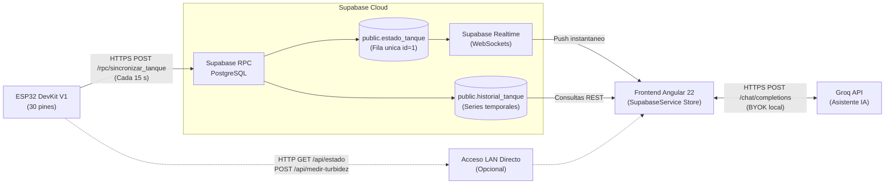

# Tanque Inteligente IoT - Frontend Web (Angular 22)

Estación web de telemetría, control y monitoreo en tiempo real para el sistema de gestión de almacenamiento de agua potable basado en la placa **ESP32 DevKit V1 (NodeMCU-32, 30 pines)**, conectado a la nube mediante **Supabase**, con asistente conversacional integrado sobre **Groq API** y enfocado en la vigilancia sanitaria bajo normativa peruana (**MINSA**).

Proyecto desarrollado para el curso de **Arquitectura del Computador** en la **Universidad Privada del Norte (UPN Trujillo)**.

---

## 1. Descripción General

Esta aplicación web actúa como la interfaz HMI / SCADA para visualizar el gemelo digital del tanque de agua. Permite supervisar niveles de reserva, litros disponibles, calidad física del agua por turbidez relativa, estado de la tapa del contenedor, estimaciones de autonomía, detección temprana de fugas o estancamiento y consultas en lenguaje natural mediante un asistente de IA.

El diseño está orientado a la precisión técnica de ingeniería, con tipografía monoespaciada tabular para mediciones de instrumentación y compatibilidad nativa con dispositivos móviles y pantallas de escritorio.

---

## 2. Arquitectura de Datos y Flujo de Comunicación



1. **Adquisición en el Microcontrolador:** El ESP32 DevKit V1 muestrea el nivel con el sensor ultrasónico JSN-SR04T cada `10 s` (mediana de 5 lecturas), vigila la tapa con el MC-38 cada `1 s` y mide la turbidez relativa con el TS-300B en `GPIO33` (`ADC1_CH5`) sin apagar la radio Wi-Fi.
2. **Transmisión Nube:** Cada `15 s`, el ESP32 envía una carga útil JSON estructurada a la función RPC atómica `sincronizar_tanque`.
3. **Persistencia y Distribución:** La base de datos actualiza el estado único (`estado_tanque`) y registra la serie temporal (`historial_tanque`).
4. **Consumo en Frontend:** La aplicación Angular recibe actualizaciones en vivo vía WebSockets (`Supabase Realtime`) sin recargar la página, contando con sondeo periódico de respaldo cuando el socket no está conectado.

---

## 3. Funcionalidades Principales

### Panel de Control (Dashboard `/dashboard`)
- **Representación gráfica del tanque HMI:** Cilindro volumétrico con regla graduada lateral en litros equivalente a `0%`, `25%`, `50%`, `75%` y `100%` de la capacidad (`7 L` o `1100 L`), cabezal con simulación del haz acústico ultrasónico (`JSN-SR04T`), menisco físico de llenado y sonda de turbidez inferior (`TS-300B`).
- **Estado de enlace y zona ciega:** Muestra fecha y hora completas de última sincronización en Perú (`-0500`), badge de estado del nodo (`EN LÍNEA` o `SIN SEÑAL`) y advertencia si la distancia ultrasónica cae dentro de la zona ciega (`< 25 cm`).
- **Lectura de instrumentación física:**
  - Nivel hidráulico porcentual y volumen en litros.
  - Columna de agua neta y distancia medida por el sensor ultrasónico (`GPIO27 / GPIO26`).
  - Turbidez física relativa en UNT con clasificación cromática (`Agua clara`, `Regular`, `Turbia (>5 UNT)`).
  - Estado del sensor magnético de tapa (`MC-38` en `GPIO25`) con contador de segundos de apertura.
  - Tasa de consumo instantáneo (`L/h`) y media ponderada diaria.
  - Proyección de días de autonomía de reserva restantes.
  - Horas continuas de agua almacenada (control de estancamiento).
  - Tiempo de actividad del procesador Xtensa Dual-Core (Uptime).
- **Vigilancia sanitaria:** Panel anunciador con cinco banderas deterministas evaluadas localmente en el firmware según el **D.S. 031-2010-SA** (MINSA).
- **Diagnóstico en red local (LAN):** Consulta directa a `http://<IP_ESP32>/api/estado` o disparo forzado de turbidez vía `POST /api/medir-turbidez`.

### Historial y Auditoría (`/history`)
- Registro cronológico de telemetría con selector de muestras (`10`, `25`, `50`, `100`).
- Resumen estadístico de nivel medio, turbidez media y conteo de muestras con alarma.
- Formato responsivo dual: tabla tabular SCADA en escritorio (`> 768px`) y tarjetas verticales en móvil (`<= 768px`).
- Huso horario estricto de Perú (`UTC-5`, `America/Lima`) en pantalla.
- Exportación instantánea a **CSV** (con BOM UTF-8 y columna `fecha_hora_peru`) y **JSON** (con metadatos y arreglo de registros).

### Asistente Conversacional IA (`/chat`)
- Integrado directamente en la aplicación web consumiendo **Groq API** (`/openai/v1/chat/completions`) con los modelos `openai/gpt-oss-120b` (por defecto) y `qwen/qwen3.8-27b` (alternativo y fallback automático ante errores `404` / `5xx`).
- Inyección dinámica de la telemetría viva, alertas activas, resumen del historial reciente y diagnóstico LAN en el mensaje `system`, aclarando explícitamente que el sistema **no certifica potabilidad microbiológica ni química**.
- Esquema **BYOK** (*Bring Your Own Key*): la API Key (`gsk_...`) se guarda exclusivamente en `localStorage` durante `72 horas` (3 días) sin exponerse en el código fuente.
- Renderizado de respuestas en Markdown GFM mediante `marked` con sanitización anti-XSS.

### Configuración de Sistema (`/settings`)
- Edición y prueba aislada de credenciales de Supabase (URL y Anon Key).
- Ajuste de IP local LAN del nodo ESP32, intervalo de respaldo (`5–120 s`) y selector de modo geométrico (`Prototipo 7 L` / `Tanque Real 1100 L`).
- Gestión local del token de Groq y selección del modelo activo.

### Experiencia Móvil (Mobile-First)
- Barra de navegación inferior fija (`mobile-bottom-nav`) con objetivos táctiles mínimos de `44px` (`--touch-target-min`) y soporte de `safe-area-inset-bottom`.

---

## 4. Sensores y Pines del Hardware (ESP32 DevKit V1)

| Sensor / Función | Pin ESP32 DevKit V1 | Destino / Acondicionamiento | Rol en el Sistema |
| :--- | :--- | :--- | :--- |
| **JSN-SR04T (TRIG)** | `GPIO27` (`D27`) | Salida digital directa | Disparo ultrasónico (pulso `12 µs`) |
| **JSN-SR04T (ECHO)** | `GPIO26` (`D26`) | Divisor resistivo `1 kΩ / 2 kΩ` (`5 V -> 3.33 V`) | Nivel, litros y distancia neta |
| **TS-300B (AO)** | `GPIO33` (`D33` / `ADC1_CH5`) | Divisor resistivo `1 kΩ / 2 kΩ` (`<= 3.00 V`), Wi-Fi activo | Turbidez relativa en UNT |
| **MC-38 (Reed)** | `GPIO25` (`D25`) | `INPUT_PULLUP` interno contra `GND` | Detección de tapa abierta / cerrada |

---

## 5. Reglas Sanitarias Evaluadas (Normativa MINSA)

| Alerta | Condición Técnica | Criterio Operacional y Sanitario |
| :--- | :--- | :--- |
| **Nivel Crítico Bajo** | `porcentaje_nivel <= 20.0%` | Prevención de desabastecimiento |
| **Tapa Abierta Prolongada** | `tapa_abierta && tiempo >= 30 s` | Prevención de ingreso del vector del Dengue (*Aedes aegypti*) |
| **Turbidez Excesiva** | `turbidez_ntu > 5.0 UNT` o `delta >= 2.5` | Límite máximo permisible fijado por el D.S. 031-2010-SA |
| **Sospecha de Fuga** | `tasa_consumo > 0.50 L/h` (2 descensos seguidos) | Detección continua de roturas o goteos |
| **Agua Estancada** | `horas_almacenada >= 72 h` (3 días) | Riesgo de proliferación de biopelículas bacterianas |

---

## 6. Pila Tecnológica

- **Framework:** [Angular 22](https://angular.dev/) (`Standalone Components`, `Signals`, `Computed States`).
- **Backend as a Service:** [Supabase](https://supabase.com/) (PostgreSQL, PostgREST RPC, Supabase Realtime vía WebSockets).
- **Cliente Nube:** `@supabase/supabase-js` (`^2.119.0`).
- **Asistente IA y Markdown:** Groq API (`fetch` nativo) + `marked` (`^18.2.1`).
- **Estilos:** CSS3 nativo con tokens SCADA, tipografía monoespaciada tabular y variables responsivas.
- **Pruebas Unitarias:** [Vitest](https://vitest.dev/) con `jsdom` mediante `@angular/build:unit-test`.
- **Compilador y Bundler:** `@angular/build` (`esbuild` + `Vite`).

---

## 7. Requisitos Previos e Instalación

- **Node.js:** Versión `20.x` o superior.
- **npm:** Versión `10.x` o superior (`packageManager: npm@11.13.0`).

```bash
git clone https://github.com/CarlitosSR/frontend_tanque-inteligente.git
cd frontend_tanque-inteligente
npm install
npm start
```

Abrir en el navegador `http://localhost:4200/`.

---

## 8. Scripts Disponibles (`package.json`)

- `npm start`: Inicia el servidor de desarrollo local (`ng serve`) en el puerto `4200`.
- `npm run build`: Compila el bundle de producción en `dist/frontend_tanque-inteligente`.
- `npm test -- --watch=false`: Ejecuta una corrida única de la suite unitaria en Vitest.
- `npm run watch`: Compilación incremental de desarrollo en modo observador.

---

## 9. Estructura del Código Fuente

```text
src/
├── environments/
│   ├── environment.ts                          # Configuración base de producción (sin secretos IA)
│   └── environment.development.ts              # Configuración para desarrollo local
├── index.html                                  # Documento HTML raíz (lang="es")
├── main.ts                                     # Bootstrap de Angular
├── styles.css                                  # Tokens SCADA, tipografía tabular y estilos .scada-md
└── app/
    ├── core/
    │   ├── models/
    │   │   ├── tanque.model.ts                 # Interfaces de telemetría, historial y configuración
    │   │   └── chatbot.model.ts                # Interfaces de token Groq y contrato Chat Completions
    │   └── services/
    │       ├── supabase.service.ts             # Cliente Supabase, Realtime, frescura de nodo y alertas MINSA
    │       ├── esp32-local.service.ts          # Comunicación HTTP directa con el nodo en LAN
    │       ├── esp32-local.service.spec.ts     # Pruebas unitarias de Esp32LocalService
    │       ├── groq-token.service.ts           # Gestión local de API Key Groq (TTL 72 h)
    │       ├── groq-token.service.spec.ts      # Pruebas unitarias de GroqTokenService
    │       ├── groq-chat.service.ts            # Prompt injection de telemetría y fallback Groq
    │       └── groq-chat.service.spec.ts       # Pruebas unitarias de GroqChatService
    ├── features/
    │   ├── dashboard/
    │   │   ├── components/
    │   │   │   ├── tank-gauge/                 # Visualizador gráfico del cilindro, menisco y pruebas .spec.ts
    │   │   │   ├── metric-card/                # Tarjetas de medición con etiqueta de hardware
    │   │   │   └── alerts-panel/               # Panel de alarmas sanitarias (D.S. 031-2010-SA)
    │   │   └── dashboard.component.ts
    │   ├── history/
    │   │   ├── history.component.ts            # Vista de series temporales y exportación CSV / JSON
    │   │   └── history.component.spec.ts       # Pruebas unitarias de HistoryComponent
    │   ├── chat/
    │   │   ├── chat.component.ts / .html / .css
    │   │   ├── markdown-chat.pipe.ts           # Renderizado GFM seguro con scadaRenderer
    │   │   └── markdown-chat.pipe.spec.ts      # Pruebas unitarias de MarkdownChatPipe
    │   └── settings/
    │       └── settings.component.ts           # Panel de configuración de enlaces, escala e IA
    ├── app.routes.ts                           # Enrutamiento lazy-loaded
    ├── app.ts / .html / .css / .spec.ts        # Shell principal y navegación responsiva
├── vercel.json                                 # Rewrites SPA y cabeceras HTTP de seguridad
└── angular.json                                # Configuración del CLI y presupuestos de empaquetado
```

---

## 10. Autores y Créditos

- **Institución:** Universidad Privada del Norte (UPN) - Sede Trujillo.
- **Curso:** Arquitectura del Computador.
- **Autores:** Espinoza Watanabe, Ryoji Steven; Pumayalla Sánchez, Jerry Heinze; Rodríguez Monzón, Gerardo Manuel; Sánchez Ruiz, Carlitos Manuel.
- **Licencia:** Proyecto académico de código abierto.
