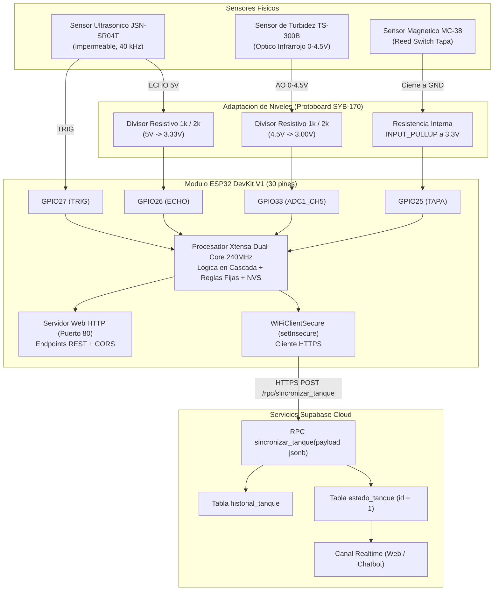
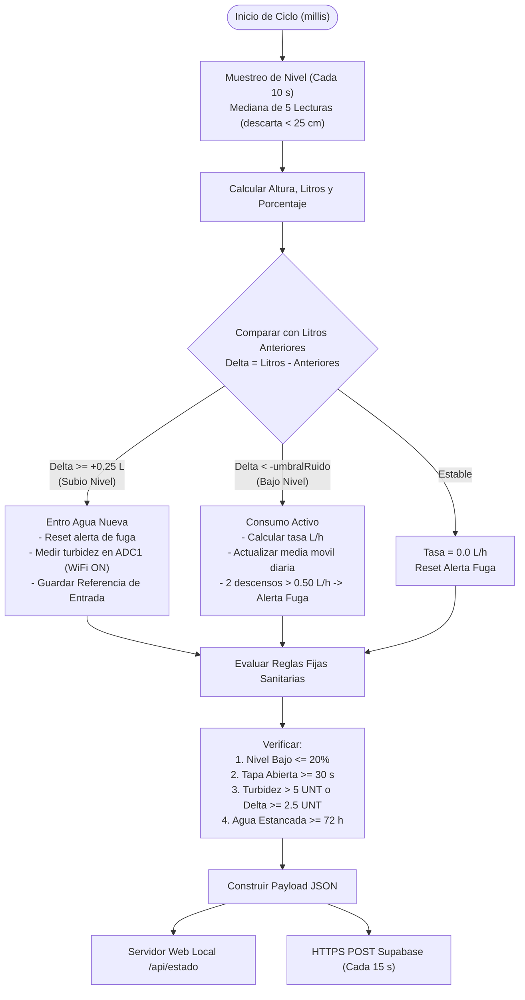

# Arquitectura del Sistema, Hardware y Circuitos

Este documento describe la arquitectura física, el diseño del circuito electrónico y las consideraciones de hardware para el proyecto **Control de Tanque Inteligente con Chatbot de IA** implementado sobre la placa de desarrollo **ESP32 DevKit V1 (NodeMCU-32, 30 pines)**.

---

## Diagrama de Bloques General



---

## Módulo Principal: ESP32 DevKit V1 (30 pines)

El sistema utiliza la placa de desarrollo **ESP32 DevKit V1** (NodeMCU-32 de 30 pines) basada en el módulo **ESP32-WROOM-32**, con conversor USB-UART **CP2102** y puerto micro-USB.

### Características de Operación
- **Microcontrolador:** ESP32-D0WDQ6 (Dual Core Tensilica Xtensa 32-bit LX6 hasta 240 MHz).
- **Memoria RAM:** 520 KB SRAM interna.
- **Memoria Flash:** 4 MB SPI Flash (con partición NVS usada para calibraciones persistentes).
- **Conectividad:** Wi-Fi 802.11 b/g/n (hasta 150 Mbps) y Bluetooth v4.2 BR/EDR y BLE.

### Gestión de Pines GPIO, Strapping Pins y ADC1
En el diseño sobre la placa de 30 pines se evitaron los pines de arranque (*strapping pins*: `GPIO0`, `GPIO2`, `GPIO5`, `GPIO12`, `GPIO15`) y los canales del `ADC2` (que comparten hardware con la radio Wi-Fi). Todas las señales quedan agrupadas en el header lateral izquierdo:

1. **GPIO27 (`D27` — Salida `TRIG` del JSN-SR04T):**
   - Pin digital estándar sin restricciones de arranque. Envía el pulso de disparo de `12 µs`.
2. **GPIO26 (`D26` — Entrada `ECHO` del JSN-SR04T):**
   - Pin digital estándar sin restricciones de arranque. Recibe el pulso del eco atenuado a `3.33 V` mediante el divisor `1 kΩ / 2 kΩ`.
3. **GPIO33 (`D33` — Entrada analógica `ADC1_CH5` del TS-300B):**
   - Al pertenecer al bloque **ADC1**, no entra en conflicto con el transceptor Wi-Fi. Permite adquirir las 20 muestras analógicas calibradas por eFuse (`analogReadMilliVolts()`) **sin apagar ni reconectar la radio Wi-Fi**.
4. **GPIO25 (`D25` — Entrada del sensor magnético MC-38):**
   - Configurado con `pinMode(PIN_MC38_TAPA, INPUT_PULLUP)`. Cuando la tapa está cerrada, el reed switch conmuta a `GND` (`LOW`); si se abre, el pull-up interno lo eleva a `3.3 V` (`HIGH`).
5. **`VIN` y `GND`:**
   - El puerto micro-USB alimenta el riel `VIN` (`~5 V`) hacia la protoboard para alimentar los sensores `JSN-SR04T` y `TS-300B`, compartiendo referencia `GND` común.

---

## Adaptación de Niveles y Divisores de Voltaje

Los pines del ESP32 operan a `3.3 V` con un máximo absoluto de `3.6 V`. Dado que el JSN-SR04T entrega `ECHO` a `5.0 V` y la salida analógica `AO` del TS-300B entrega hasta `4.5 V`, ambos pasan por divisores pasivos `R1 = 1 kΩ` / `R2 = 2 kΩ` (`1/4 W`):

```text
       Vin (Sensor 5V / 4.5V)
               │
               ┌┴┐
               │ │  R1 = 1 kOhm
               └┬┘
                ├───────────> Vout (Al Pin del ESP32 <= 3.33V)
               ┌┴┐
               │ │  R2 = 2 kOhm
               └┬┘
                │
               GND (Comun)
```

$$V_{out} = V_{in} \cdot \frac{R_2}{R_1 + R_2} = V_{in} \cdot \frac{2000}{1000 + 2000} = V_{in} \cdot \frac{2}{3}$$

El factor de escala inverso aplicado en el firmware es $\text{FACTOR\_DIVISOR\_1K\_2K} = 1.50$.

- **JSN-SR04T (`ECHO` → `GPIO26`):** $5.00 \cdot \frac{2}{3} = 3.33\text{ V}$.
- **TS-300B (`AO` → `GPIO33` / `ADC1_CH5`):** $4.50 \cdot \frac{2}{3} = 3.00\text{ V}$ (dentro del rango lineal de `0–3.30 V` con `ADC_11db`).

---

## Sensores del Sistema

### 1. Sensor Ultrasónico Impermeable JSN-SR04T
- **Transductor:** piezoeléctrico sellado (40 kHz, IP67) montado sobre el tanque.
- **Rango útil:** `25 cm` hasta `450 cm` (zona ciega física de `25 cm`).
- **Calibración en prototipo (botella PET de 7 L, diámetro `16.80 cm`, altura útil `31.60 cm`):** la altura sensor-fondo (valor inicial `50.00 cm`) se ajusta por Monitor Serial con el comando `H<cm>` y se guarda en NVS (`Preferences`).

### 2. Sensor Óptico de Turbidez TS-300B / TSW-30
- **Principio:** transmitancia infrarroja entre emisor IR y fototransistor. No sustituye un turbidímetro certificado; proporciona turbidez relativa de alerta temprana frente al límite de `5.0 UNT` del **D.S. 031-2010-SA**.
- **Calibración:** admite comando Serial `T` en agua potable limpia para compensar la caída de tensión del diodo de `VIN` y guardar la referencia en NVS.

### 3. Sensor Magnético de Tapa MC-38
- **Comportamiento:** contacto normalmente abierto (NO) accionado por imán (`15–25 mm`). Tapa cerrada → `LOW`; tapa abierta → `HIGH` con temporizador sanitario de `30 s`.

---

## Lógica en Cascada del Sistema


