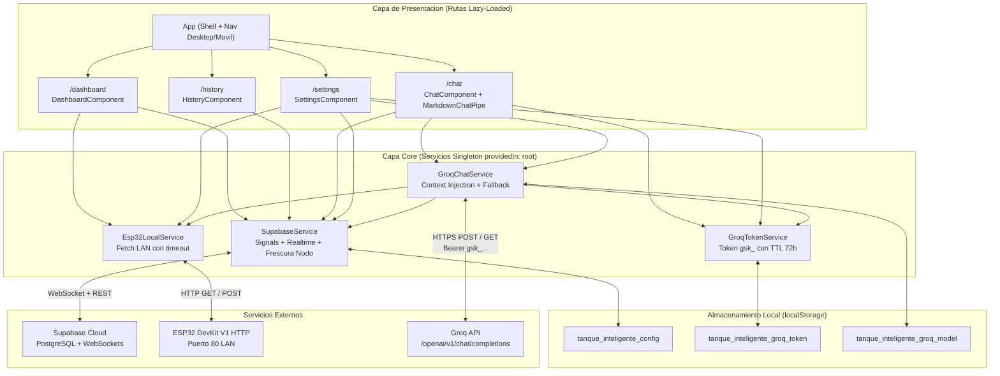

# Arquitectura del Frontend Web (Angular 22)

Este documento describe la arquitectura de software, el flujo de datos reactivo, la estructura de módulos y el sistema de diseño de la aplicación web **Control de Tanque Inteligente**, desarrollada en **Angular 22** como interfaz HMI / SCADA para el monitoreo hídrico y sanitario.

---

## 1. Visión General y Pila Tecnológica

El frontend opera como una aplicación de página única (SPA) basada en componentes `standalone`, gestión de estado mediante **Angular Signals** y carga diferida (*lazy loading*) de rutas. Se comunica directamente con tres interfaces externas sin requerir un servidor intermedio propio:

- **Supabase Cloud (`@supabase/supabase-js`):** Lectura del estado en vivo (`public.estado_tanque`), recepción de actualizaciones en tiempo real por WebSockets (`supabase_realtime`), sondeo periódico de respaldo cuando el socket no está conectado y consulta de series temporales (`public.historial_tanque`).
- **Nodo ESP32 DevKit V1 en Red Local (LAN):** Comunicación HTTP directa opcional contra el servidor embebido del microcontrolador (`/api/estado` y `/api/medir-turbidez`).
- **Groq API (OpenAI-Compatible):** Asistente conversacional de IA en el navegador mediante `fetch` nativo hacia `https://api.groq.com/openai/v1`, con credencial personal gestionada exclusivamente en el cliente (`localStorage`).

| Tecnología / Librería | Versión / Base | Uso en el Frontend |
| :--- | :--- | :--- |
| **Angular** | `^22.0.0` | Framework principal (`standalone`, `signal`, `computed`, `effect`, `viewChild`) |
| **@angular/build / @angular/cli** | `^22.0.0` | Compilador (`esbuild` + `Vite`) y runner `@angular/build:unit-test` |
| **@supabase/supabase-js** | `^2.119.0` | Cliente PostgREST y canal Realtime WebSocket |
| **marked** | `^18.2.1` | Parseo GitHub Flavored Markdown (GFM) para respuestas del chatbot |
| **RxJS** | `~7.8.0` | Dependencia base del ecosistema Angular |
| **TypeScript** | `~6.0.2` | Tipado estricto de modelos de telemetría y contratos API |
| **Vitest + jsdom** | `^4.0.8` / `^28.0.0` | Pruebas unitarias mediante `@angular/build:unit-test` |

---

## 2. Diagrama de Arquitectura del Frontend



---

## 3. Estructura del Código Fuente

```text
src/
├── environments/
│   ├── environment.ts                          # Configuración base de producción (sin secretos IA)
│   └── environment.development.ts              # Configuración para desarrollo local
├── index.html                                  # Documento HTML raíz (lang="es")
├── main.ts                                     # Bootstrap de Angular
├── styles.css                                  # Tokens SCADA, tipografía tabular y estilos .scada-md
└── app/
    ├── app.ts                                  # Componente raíz (inyecta SupabaseService)
    ├── app.html                                # Cabecera fija, router-outlet y barra móvil inferior
    ├── app.css                                 # Layout general y media queries (< 768px)
    ├── app.routes.ts                           # Enrutamiento lazy-loaded (/dashboard, /history, /chat, /settings)
    ├── app.config.ts                           # Providers globales (provideRouter, error listeners)
    ├── app.spec.ts                             # Pruebas unitarias del componente raíz
    ├── core/
    │   ├── models/
    │   │   ├── tanque.model.ts                 # EstadoTanque, HistorialTanque, Esp32EstadoRespuesta, AlertaItem, ConfiguracionSistema
    │   │   └── chatbot.model.ts                # GroqTokenRegistro, ChatMensaje, GroqChatRequest/Response, GroqModelsResponse
    │   └── services/
    │       ├── supabase.service.ts             # Estado reactivo, Realtime WebSocket, frescura de nodo, polling y alertas MINSA
    │       ├── esp32-local.service.ts          # Peticiones HTTP directas a /api/estado y /api/medir-turbidez
    │       ├── esp32-local.service.spec.ts     # Pruebas unitarias de Esp32LocalService
    │       ├── groq-token.service.ts           # Ciclo de vida de API Key Groq (3 días) en localStorage
    │       ├── groq-token.service.spec.ts      # Pruebas unitarias de GroqTokenService
    │       ├── groq-chat.service.ts            # Prompt injection de telemetría, historial y consumo Groq API
    │       └── groq-chat.service.spec.ts       # Pruebas unitarias de GroqChatService
    └── features/
        ├── dashboard/
        │   ├── dashboard.component.ts
        │   └── components/
        │       ├── tank-gauge/
        │       │   ├── tank-gauge.component.ts
        │       │   └── tank-gauge.component.spec.ts
        │       ├── metric-card/metric-card.component.ts
        │       └── alerts-panel/alerts-panel.component.ts
        ├── history/
        │   ├── history.component.ts
        │   └── history.component.spec.ts
        ├── chat/
        │   ├── chat.component.ts
        │   ├── chat.component.html
        │   ├── chat.component.css
        │   ├── markdown-chat.pipe.ts
        │   └── markdown-chat.pipe.spec.ts
        └── settings/
            └── settings.component.ts
```

---

## 4. Servicios del Núcleo (`src/app/core/services/`)

### `SupabaseService` ([`supabase.service.ts`](../../src/app/core/services/supabase.service.ts))
Centraliza la conexión y el estado reactivo de la telemetría del tanque:
- **Señales principales:** `configuracion`, `estadoActual`, `historial`, `cargando`, `cargandoHistorial`, `conectadoRealtime`, `errorConexion`, `ultimaActualizacion`.
- **Señales derivadas (`computed`):**
  - `calidadAgua`: Clasifica la turbidez según `limiteMinsaTurbidezNtu` (`> 5.0 UNT` o `alerta_turbidez_alta` crítica con `--status-crit`, `> 2.5 UNT` moderada con `--status-warn`, `<= 2.5 UNT` óptima con `--status-normal`).
  - `alertasActivas`: Construye el arreglo `AlertaItem[]` evaluando las 5 banderas deterministas recibidas del microcontrolador (`alerta_nivel_bajo`, `alerta_tapa_abierta`, `alerta_turbidez_alta`, `alerta_fuga`, `alerta_estancada`).
  - `capacidadNominalLitros`: Retorna `7.0` L (`prototipo_7l`) u `1100.0` L (`real_1100l`).
  - `nodoEnLinea` y `tiempoSinSyncTexto`: Evalúan la frescura de `estadoActual().updated_at` contra un reloj interno (`15 s`) para detectar si el nodo ESP32 lleva tiempo sin transmitir.
- **Sincronización y prueba aislada:** Al instanciarse abre el canal Realtime `canal-estado-tanque-live` escuchando eventos `postgres_changes` sobre `public.estado_tanque` (`filter: 'id=eq.1'`), ejecuta una lectura inicial de estado e historial (25 muestras) y mantiene un sondeo de respaldo (`setInterval` mínimo `5 s`) que solo consulta cuando `!conectadoRealtime()`. Además, `probarCredenciales(url, anonKey)` valida nuevas credenciales en un cliente aislado antes de guardarlas.

### `Esp32LocalService` ([`esp32-local.service.ts`](../../src/app/core/services/esp32-local.service.ts))
Permite diagnóstico directo cuando el operador se encuentra en la misma subred Wi-Fi que el ESP32 DevKit V1:
- Normaliza la IP o host agregando `http://` si falta.
- `obtenerEstadoLocal(ip)`: Ejecuta `GET <base>/api/estado` con `AbortSignal.timeout(6000)`.
- `forzarMedicionTurbidez(ip)`: Ejecuta `POST <base>/api/medir-turbidez` con `AbortSignal.timeout(8000)`.
- Almacena la respuesta extendida `Esp32EstadoRespuesta` en la señal `ultimoResultado`, la cual incluye `en_zona_ciega_jsn` y los voltajes analógicos (`voltaje_pin_io14_v`, `voltaje_sensor_ts300b_v`).

### `GroqTokenService` y `GroqChatService`
Gestionan la credencial de IA solo en el navegador (vigencia de 3 días) y la comunicación con Groq API con inyección dinámica de telemetría. Su diseño detallado se documenta en [asistente-ia-groq.md](./asistente-ia-groq.md).

---

## 5. Variables de Entorno y Persistencia Local

### Configuración de Entorno (`src/environments/`)
Tanto [`environment.ts`](../../src/environments/environment.ts) como [`environment.development.ts`](../../src/environments/environment.development.ts) definen parámetros operativos y endpoints públicos. Ningún token privado de IA se almacena en el código fuente:

| Propiedad | Valor Base | Descripción |
| :--- | :--- | :--- |
| `production` | `true` / `false` | Indicador de modo de compilación |
| `supabaseUrl` | `https://qdiscbtpsbvpbrndjsnb.supabase.co` | Endpoint del proyecto Supabase |
| `supabaseAnonKey` | `sb_publishable_...` | Clave pública cliente para lectura y Realtime |
| `esp32DefaultIp` | `''` | IP local por defecto del nodo ESP32 DevKit V1 |
| `tanquePrototipoCapacidadLitros` | `7.0` | Volumen nominal del prototipo de laboratorio |
| `tanqueRealCapacidadLitros` | `1100.0` | Volumen nominal de tanque doméstico |
| `limiteMinsaTurbidezNtu` | `5.0` | Límite máximo de turbidez física (D.S. 031-2010-SA) |
| `groqApiBaseUrl` | `https://api.groq.com/openai/v1` | URL base compatible con OpenAI de Groq |
| `groqDefaultModel` | `'openai/gpt-oss-120b'` | Modelo de IA seleccionado por defecto |
| `groqAvailableModels` | `['openai/gpt-oss-120b', 'qwen/qwen3.8-27b']` | Modelos habilitados en selector y fallback |
| `groqTokenTtlDias` | `3` | Vigencia máxima del token en `localStorage` (72 horas) |

### Claves en `localStorage`

| Clave | Servicio Propietario | Contenido | Vigencia |
| :--- | :--- | :--- | :--- |
| `tanque_inteligente_config` | `SupabaseService` | `ConfiguracionSistema` (URL, Anon Key, IP ESP32, polling, modo tanque) | Permanente hasta restablecer |
| `tanque_inteligente_groq_token` | `GroqTokenService` | `{ token, creadoEn, expiraEn }` | 3 días (72 horas) |
| `tanque_inteligente_groq_model` | `GroqChatService` | ID del último modelo seleccionado en UI | Permanente |

Adicionalmente, `GroqTokenService` limpia de forma automática cualquier residuo de la clave heredada `tanque_inteligente_gemini_token` al inicializar.

---

## 6. Sistema de Diseño SCADA, Navegación Responsiva y Rutas

El archivo global [`styles.css`](../../src/styles.css) define una interfaz oscura de alto contraste orientada a instrumentación:

- **Superficies:** `--bg-primary` (`#0a0f1d`), `--bg-surface` (`#111827`), `--bg-surface-raised` (`#1f2937`).
- **Estados operativos:** `--status-normal` (`#10b981`), `--status-warn` (`#f59e0b`), `--status-crit` (`#ef4444`), `--status-info` (`#0284c7`).
- **Tipografía tabular:** La clase `.mono-val` aplica `--font-mono` y `font-variant-numeric: tabular-nums` para evitar saltos horizontales al actualizar mediciones en tiempo real.
- **Adaptación móvil (`@media (max-width: 768px)` en [`app.css`](../../src/app/app.css)):** Oculta la barra superior de escritorio (`.desktop-nav`) y fija una barra inferior ergonómica (`.mobile-bottom-nav`) con objetivos táctiles de al menos `44px` (`--touch-target-min`) y soporte de `safe-area-inset-bottom`.

### Tabla de Rutas ([`app.routes.ts`](../../src/app/app.routes.ts))

| Ruta | Etiqueta en Navegación | Componente Cargado |
| :--- | :--- | :--- |
| `/dashboard` | `Monitor` | `DashboardComponent` |
| `/history` | `Historial` | `HistoryComponent` |
| `/chat` | `Asistente` | `ChatComponent` |
| `/settings` | `Ajustes` | `SettingsComponent` |
| `''` / `**` | Redirección automática | `/dashboard` |
