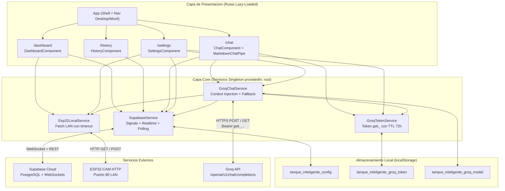

# Arquitectura del Frontend Web (Angular 22)

Este documento describe la arquitectura de software, el flujo de datos reactivo, la estructura de modulos y el sistema de diseno de la aplicacion web **Control de Tanque Inteligente**, desarrollada en **Angular 22** como interfaz HMI / SCADA para el monitoreo hidrico y sanitario.

---

## 1. Vision General y Pila Tecnologica

El frontend opera como una aplicacion de pagina unica (SPA) basada en componentes `standalone`, gestion de estado mediante **Angular Signals** y carga diferida (*lazy loading*) de rutas. Se comunica directamente con tres interfaces externas sin requerir un servidor intermedio propio:

- **Supabase Cloud (`@supabase/supabase-js`):** Lectura del estado en vivo (`public.estado_tanque`), recepcion de actualizaciones en tiempo real por WebSockets (`supabase_realtime`), sondeo periodico de respaldo y consulta de series temporales (`public.historial_tanque`).
- **Nodo ESP32-CAM en Red Local (LAN):** Comunicacion HTTP directa opcional contra el servidor embebido del microcontrolador (`/api/estado` y `/api/medir-turbidez`).
- **Groq API (OpenAI-Compatible):** Asistente conversacional de IA en el navegador mediante `fetch` nativo hacia `https://api.groq.com/openai/v1`, con credencial personal gestionada exclusivamente en el cliente (`localStorage`).

| Tecnologia / Libreria | Version / Base | Uso en el Frontend |
| :--- | :--- | :--- |
| **Angular** | `^22.0.0` | Framework principal (`standalone`, `signal`, `computed`, `effect`, `viewChild`) |
| **@supabase/supabase-js** | `^2.119.0` | Cliente PostgREST y canal Realtime WebSocket |
| **marked** | Instalado en `package.json` | Parseo GitHub Flavored Markdown (GFM) para respuestas del chatbot |
| **RxJS** | `~7.8.0` | Dependencia base del ecosistema Angular |
| **TypeScript** | `~6.0.2` | Tipado estricto de modelos de telemetria y contratos API |
| **Vitest + jsdom** | `^4.0.8` / `^28.0.0` | Pruebas unitarias mediante `@angular/build:unit-test` |

---

## 2. Diagrama de Arquitectura del Frontend



---

## 3. Estructura del Codigo Fuente

```text
src/
├── environments/
│   ├── environment.ts                  # Configuracion base de produccion (sin secretos IA)
│   └── environment.development.ts      # Configuracion para desarrollo local
├── index.html                          # Documento HTML raiz
├── main.ts                             # Bootstrap de Angular
├── styles.css                          # Tokens SCADA, tipografia tabular y estilos .scada-md
└── app/
    ├── app.ts                          # Componente raiz (inyecta SupabaseService)
    ├── app.html                        # Cabecera fija, router-outlet y barra movil inferior
    ├── app.css                         # Layout general y media queries (< 768px)
    ├── app.routes.ts                   # Enrutamiento lazy-loaded (/dashboard, /history, /chat, /settings)
    ├── app.config.ts                   # Providers globales (provideRouter, error listeners)
    ├── app.spec.ts                     # Pruebas unitarias del componente raiz
    ├── core/
    │   ├── models/
    │   │   ├── tanque.model.ts         # EstadoTanque, HistorialTanque, Esp32EstadoRespuesta, AlertaItem, ConfiguracionSistema
    │   │   └── chatbot.model.ts        # GroqTokenRegistro, ChatMensaje, GroqChatRequest/Response, GroqModelsResponse
    │   └── services/
    │       ├── supabase.service.ts     # Estado reactivo, Realtime WebSocket, polling y alertas MINSA
    │       ├── esp32-local.service.ts  # Peticiones HTTP directas a /api/estado y /api/medir-turbidez
    │       ├── groq-token.service.ts   # Ciclo de vida de API Key Groq (3 dias) en localStorage
    │       └── groq-chat.service.ts    # Prompt injection de telemetria, historial y consumo Groq API
    └── features/
        ├── dashboard/
        │   ├── dashboard.component.ts
        │   └── components/
        │       ├── tank-gauge/tank-gauge.component.ts
        │       ├── metric-card/metric-card.component.ts
        │       └── alerts-panel/alerts-panel.component.ts
        ├── history/
        │   └── history.component.ts
        ├── chat/
        │   ├── chat.component.ts
        │   ├── chat.component.html
        │   ├── chat.component.css
        │   └── markdown-chat.pipe.ts
        └── settings/
            └── settings.component.ts
```

---

## 4. Servicios del Nucleo (`src/app/core/services/`)

### `SupabaseService`
Centraliza la conexion y el estado reactivo de la telemetria del tanque:
- **Senales principales:** `configuracion`, `estadoActual`, `historial`, `cargando`, `cargandoHistorial`, `conectadoRealtime`, `errorConexion`, `ultimaActualizacion`.
- **Senales derivadas (`computed`):**
  - `calidadAgua`: Clasifica la turbidez segun `limiteMinsaTurbidezNtu` (`> 5.0 UNT` critica, `> 2.5 UNT` moderada, `<= 2.5 UNT` optima).
  - `alertasActivas`: Construye el arreglo `AlertaItem[]` evaluando las 5 banderas deterministas recibidas del microcontrolador (`alerta_nivel_bajo`, `alerta_tapa_abierta`, `alerta_turbidez_alta`, `alerta_fuga`, `alerta_estancada`).
  - `capacidadNominalLitros`: Retorna `7.0` L (`prototipo_7l`) u `1100.0` L (`real_1100l`).
- **Sincronizacion:** Al instanciarse abre el canal Realtime `canal-estado-tanque-live` escuchando eventos `postgres_changes` sobre `public.estado_tanque` (`filter: 'id=eq.1'`), ejecuta una lectura inicial de estado e historial (25 muestras) y mantiene un sondeo de respaldo (`setInterval`) con un minimo de 5 segundos (`Math.max(5, intervaloRefrescoSeg || 15)`).

### `Esp32LocalService`
Permite diagnostico directo cuando el operador se encuentra en la misma subred WiFi que el ESP32-CAM:
- Normaliza la IP o host agregando `http://` si falta.
- `obtenerEstadoLocal(ip)`: Ejecuta `GET <base>/api/estado` con `AbortSignal.timeout(6000)`.
- `forzarMedicionTurbidez(ip)`: Ejecuta `POST <base>/api/medir-turbidez` con `AbortSignal.timeout(8000)`.
- Almacena la respuesta extendida `Esp32EstadoRespuesta` en la senal `ultimoResultado`, la cual incluye `en_zona_ciega_jsn` y los voltajes analogicos (`voltaje_pin_io14_v`, `voltaje_sensor_ts300b_v`).

### `GroqTokenService` y `GroqChatService`
Gestionan la credencial de IA solo en el navegador (vigencia de 3 dias) y la comunicacion con Groq API con inyeccion dinamica de telemetria. Su diseno detallado se documenta en [asistente-ia-groq.md](file:///D:/Proyectos/UPN/Arq_Computador/frontend_tanque-inteligente/docs/docs_frontend/asistente-ia-groq.md).

---

## 5. Variables de Entorno y Persistencia Local

### Configuracion de Entorno (`src/environments/`)
Tanto `environment.ts` como `environment.development.ts` definen parametros operativos y endpoints publicos. Ningun token privado de IA se almacena en el codigo fuente:

| Propiedad | Valor Base | Descripcion |
| :--- | :--- | :--- |
| `supabaseUrl` | `https://qdiscbtpsbvpbrndjsnb.supabase.co` | Endpoint del proyecto Supabase |
| `supabaseAnonKey` | `sb_publishable_...` | Clave publica cliente para lectura y Realtime |
| `esp32DefaultIp` | `''` | IP local por defecto del nodo ESP32-CAM |
| `tanquePrototipoCapacidadLitros` | `7.0` | Volumen nominal del prototipo de laboratorio |
| `tanqueRealCapacidadLitros` | `1100.0` | Volumen nominal de tanque domestico |
| `limiteMinsaTurbidezNtu` | `5.0` | Limite maximo de turbidez fisica (D.S. 031-2010-SA) |
| `groqApiBaseUrl` | `https://api.groq.com/openai/v1` | URL base compatible con OpenAI de Groq |
| `groqDefaultModel` | `'openai/gpt-oss-120b'` | Modelo de IA seleccionado por defecto |
| `groqAvailableModels` | `['openai/gpt-oss-120b', 'qwen/qwen3.8-27b']` | Modelos habilitados en selector y fallback |
| `groqTokenTtlDias` | `3` | Vigencia maxima del token en `localStorage` (72 horas) |

### Claves en `localStorage`

| Clave | Servicio Propietario | Contenido | Vigencia |
| :--- | :--- | :--- | :--- |
| `tanque_inteligente_config` | `SupabaseService` | `ConfiguracionSistema` (URL, Anon Key, IP ESP32, polling, modo tanque) | Permanente hasta restablecer |
| `tanque_inteligente_groq_token` | `GroqTokenService` | `{ token, creadoEn, expiraEn }` | 3 dias (72 horas) |
| `tanque_inteligente_groq_model` | `GroqChatService` | ID del ultimo modelo seleccionado en UI | Permanente |

Adicionalmente, `GroqTokenService` limpia de forma automatica cualquier residuo de la clave heredada `tanque_inteligente_gemini_token` al inicializar.

---

## 6. Sistema de Diseno SCADA y Navegacion Responsiva

El archivo global [styles.css](file:///D:/Proyectos/UPN/Arq_Computador/frontend_tanque-inteligente/src/styles.css) define una interfaz oscura de alto contraste orientada a instrumentacion:

- **Superficies:** `--bg-primary` (`#0a0f1d`), `--bg-surface` (`#111827`), `--bg-surface-raised` (`#1f2937`).
- **Estados operativos:** `--status-normal` (`#10b981`), `--status-warn` (`#f59e0b`), `--status-crit` (`#ef4444`), `--status-info` (`#0284c7`).
- **Tipografia tabular:** La clase `.mono-val` aplica `--font-mono` y `font-variant-numeric: tabular-nums` para evitar saltos horizontales al actualizar mediciones en tiempo real.
- **Adaptacion movil (`@media (max-width: 768px)` en `app.css`):** Oculta la barra superior de escritorio (`.desktop-nav`) y fija una barra inferior ergonomica (`.mobile-bottom-nav`) con objetivos tactiles de al menos `44px` (`--touch-target-min`) y soporte de `safe-area-inset-bottom`.

### Tabla de Rutas (`app.routes.ts`)

| Ruta | Etiqueta en Navegacion | Componente Cargado |
| :--- | :--- | :--- |
| `/dashboard` | `Monitor` | `DashboardComponent` |
| `/history` | `Historial` | `HistoryComponent` |
| `/chat` | `Asistente` | `ChatComponent` |
| `/settings` | `Ajustes` | `SettingsComponent` |
| `''` / `**` | Redireccion automatica | `/dashboard` |
