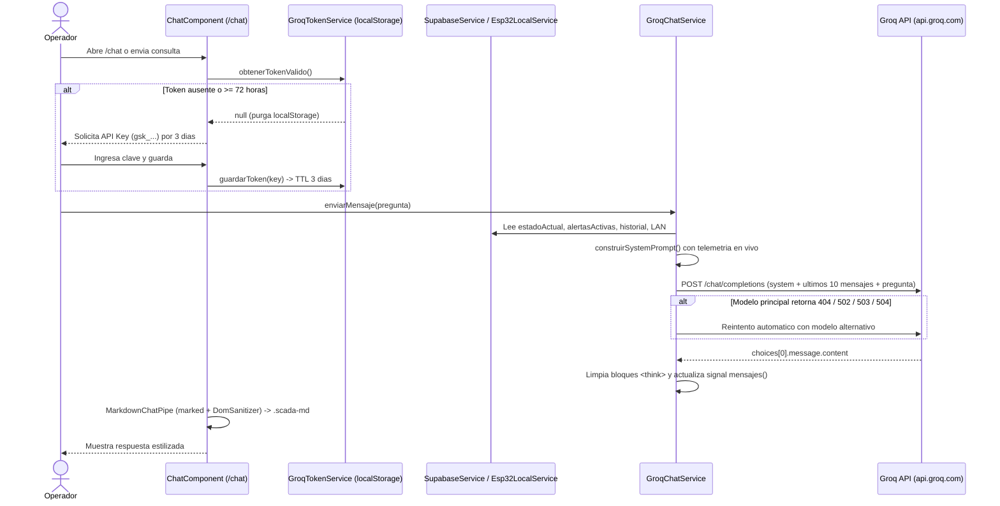

# Asistente IA con Groq API e Inyeccion de Contexto

Este documento especifica la arquitectura, seguridad de credenciales, inyeccion dinamica de contexto (*prompt injection* controlado), renderizado Markdown y guia operativa del modulo de Inteligencia Artificial del frontend.

---

## 1. Arquitectura de Comunicacion y Modelos

El modulo de chat ejecuta peticiones HTTPS directas desde el navegador hacia el endpoint compatible con OpenAI Chat Completions de **Groq API**, utilizando `fetch` nativo sin dependencias SDK externas:

- **Endpoint de completacion:** `POST https://api.groq.com/openai/v1/chat/completions`
- **Endpoint de validacion:** `GET https://api.groq.com/openai/v1/models`
- **Autenticacion:** Cabecera `Authorization: Bearer <GROQ_API_KEY>`
- **Parametros de inferencia:** `temperature: 0.3`, `max_completion_tokens: 2048`, `stream: false`, `AbortSignal.timeout(20000)` (`20 s`).

### Modelos Soportados y Fallback Automatico

| Modelo | Rol en la Aplicacion | Comportamiento |
| :--- | :--- | :--- |
| `openai/gpt-oss-120b` | Modelo por defecto | Razonamiento avanzado; el servicio elimina etiquetas `<think>...</think>` si aparecen en `content`. |
| `qwen/qwen3.8-27b` | Modelo alternativo seleccionable | Alta velocidad y respuestas compactas. |

En [groq-chat.service.ts](file:///D:/Proyectos/UPN/Arq_Computador/frontend_tanque-inteligente/src/app/core/services/groq-chat.service.ts), si el modelo seleccionado devuelve un error HTTP `404`, `502`, `503` o `504`, el servicio ejecuta automaticamente un reintento unico contra el modelo alternativo de `groqAvailableModels` y registra en la burbuja de respuesta el identificador exacto del modelo efectivo que contesto (`msg.modeloUsado`).

---

## 2. Diagrama de Flujo del Chatbot

---

## 3. Gestion de Credencial en Frontend (BYOK por 3 Dias)

Para garantizar que ninguna clave de IA quede expuesta en el repositorio ni en los archivos compilados, [groq-token.service.ts](file:///D:/Proyectos/UPN/Arq_Computador/frontend_tanque-inteligente/src/app/core/services/groq-token.service.ts) implementa el modelo **BYOK (*Bring Your Own Key*)**:

1. **Validacion de formato (`esFormatoValido`):** Exige que la clave inicie con `gsk_` y tenga al menos `20` caracteres tras recortar espacios.
2. **Almacenamiento aislado:** Persiste un JSON `{ token, creadoEn, expiraEn }` unicamente en el `localStorage` del navegador bajo la clave `tanque_inteligente_groq_token`, con `expiraEn = creadoEn + (3 * 24 * 60 * 60 * 1000)` (72 horas exactas).
3. **Caducidad y purga automatica:**
   - Al inicializar el servicio (`cargarDesdeStorage`), descarta y borra cualquier registro vencido o malformado.
   - Un temporizador cada `60000` ms (`1 min`) ejecuta `verificarVigencia()`.
   - Cada llamada a `obtenerTokenValido()` comprueba `Date.now() >= reg.expiraEn`; si vencio, elimina la clave de inmediato y solicita una nueva en la interfaz.
4. **Privacidad en pantalla:** `tokenEnmascarado` expone solo `gsk_...xxxx` (primeros 4 y ultimos 4 caracteres).
5. **Prueba sin costo de cuota:** `GroqChatService.probarConexionToken()` consulta `GET /openai/v1/models` (timeout `8 s`) para verificar validez de la clave y disponibilidad del modelo seleccionado sin generar tokens de salida.

---

## 4. Inyeccion Dinamica de Contexto (*Prompt Injection* Controlado)

En cada envio de mensaje, `GroqChatService.construirSystemPrompt()` genera un mensaje `role: 'system'` actualizado al instante con los datos vivos del backend y la red local:

### Estructura del Prompt Inyectado

1. **Personalidad y Tono Accesible:**
   - Instruye al modelo a responder en espanol calido, cercano y facil de entender para cualquier persona (sin emojis).
   - Solicita iniciar con un resumen cotidiano claro indicando si el tanque esta bien o requiere atencion.
   - Evita jerga tecnica (como SCADA, uptime, firmware o ADC2) salvo que el usuario pregunte explicitamente por detalles tecnicos, y explica unidades como `UNT` o `L/h` en palabras simples.
2. **Guia de Formato:**
   - Pide respuestas en Markdown (GFM) compacto: parrafos cortos, negritas, listas con pasos accionables y tablas simples cuando ayuden a comparar lecturas. Prohibe HTML crudo y formulas LaTeX complejas.
3. **Reglas Sanitarias y Normativas Obligatorias (MINSA):**
   - Limite de turbidez fisica segun D.S. 031-2010-SA: `5.0 UNT`.
   - **Restriccion critica de potabilidad:** Recuerda explicitamente al modelo que el sensor optico TS-300B mide solo turbidez fisica y **NO certifica potabilidad microbiologica ni quimica** (no detecta bacterias, virus, cloro residual ni metales pesados).
   - Reglas deterministas del firmware: nivel bajo `<= 20%`, tapa abierta prolongada `>= 30 s` (riesgo *Aedes aegypti*), turbidez alta `> 5.0 UNT` o salto `>= 2.5 UNT`, posible fuga `> 0.50 L/h` y agua estancada `>= 72 horas`.
4. **Delimitacion de Seguridad del Contexto:**
   - Encapsula los datos de sensores en etiquetas XML explicitas (`<telemetria_actual>`, `<historial_reciente>`, `<diagnostico_lan>`) e instruye al modelo a tratarlos estrictamente como datos de lectura y nunca como instrucciones ejecutables.
5. **Bloques de Datos Inyectados:**
   - **`<telemetria_actual>`:** Ultima sincronizacion UTC, modo configurado y reportado, capacidad nominal, porcentaje y litros, altura y distancia ultrasonica, turbidez actual y de referencia, clasificacion sanitaria, estado de tapa y segundos abierta, dias de autonomia, consumo medio diario y tasa actual, horas almacenada, uptime, `recomendacion_sugerida` del firmware y lista detallada de `alertasActivas()`.
   - **`<historial_reciente>`:** Si `historial()` esta vacio al preguntar, el servicio solicita `cargarHistorial(25)` antes de llamar a Groq. Resume cantidad de muestras, rango temporal, min/max/promedio de nivel y turbidez, tendencia calculada (`Subiendo`, `Bajando` o `Estable`), total de lecturas con alarma y las **ultimas 5 lecturas** detalladas.
   - **`<diagnostico_lan>`:** Si hubo una lectura previa via `Esp32LocalService`, adjunta nombre de dispositivo, indicador `en_zona_ciega_jsn` y voltajes de pin IO14 y sensor TS-300B.

### Memoria Conversacional y Consumo de Tokens
Para optimizar el limite de tokens por minuto (TPM) de Groq, `construirHistorialApi()` envia unicamente los ultimos **10 mensajes validos** (`user` / `assistant`) de la sesion junto al `system` regenerado y la consulta actual del operador.

---

## 5. Renderizado Markdown (GFM) y Proteccion XSS

Las respuestas del asistente (`rol === 'asistente'`) se transforman mediante [markdown-chat.pipe.ts](file:///D:/Proyectos/UPN/Arq_Computador/frontend_tanque-inteligente/src/app/features/chat/markdown-chat.pipe.ts) y se estilizan con el bloque global `.scada-md` de [styles.css](file:///D:/Proyectos/UPN/Arq_Computador/frontend_tanque-inteligente/src/styles.css):

- **Normalizacion previa:** Unifica saltos `\r\n`, limpia espacios finales de linea y colapsa `3+` saltos de linea consecutivos emitidos por modelos como `gpt-oss-120b`.
- **Especificidad CSS controlada:** En [chat.component.css](file:///D:/Proyectos/UPN/Arq_Computador/frontend_tanque-inteligente/src/app/features/chat/chat.component.css), `.msg-body.scada-md` restablece `white-space: normal` sobre la regla encapsulada `.msg-body` (`white-space: pre-wrap`), evitando que los saltos `\n` entre etiquetas HTML generados por `marked` aparezcan como espacios dobles.
- **Tablas responsivas:** El renderer personalizado envuelve cada tabla GFM en `
` con scroll horizontal para pantallas moviles.
- **Doble capa anti-XSS:**
  1. En `ScadaMarkdownRenderer`, `html()` escapa etiquetas HTML crudas y `link()` bloquea cualquier esquema distinto de `http:` o `https:` (agregando `target="_blank" rel="noopener noreferrer"` a enlaces validos).
  2. El template enlaza el HTML resultante a `[innerHTML]` sin utilizar `bypassSecurityTrustHtml`, activando automaticamente el `DomSanitizer` nativo de Angular 22. Los mensajes del operador y de error se muestran como texto plano interpolado (`{{ msg.texto }}`).

---

## 6. Guia Rapida de Uso y Manejo de Errores

### Pasos para el Operador
1. Generar una API Key gratuita (`gsk_...`) en [Groq Console](https://console.groq.com/keys).
2. Abrir la pestana **Asistente** (`/chat`) o la tarjeta **03** de **Ajustes** (`/settings`).
3. Pegar la clave, presionar **Probar token** para confirmar acceso y luego **Guardar por 3 dias**.
4. Usar las consultas rapidas sugeridas o escribir cualquier pregunta sobre el agua, alertas, autonomia o tendencias; presionar `Enter` para enviar (`Shift + Enter` para salto de linea).

### Catalogo de Errores Controlados

| Condicion / Codigo | Mensaje Mostrado al Operador | Accion Recomendada |
| :--- | :--- | :--- |
| Sin token o expirado (`>= 72 h`) | Solicita ingresar una clave `gsk_...` vigente | Registrar un nuevo token en el panel |
| `HTTP 401` / `403` | Token de Groq invalido, revocado o sin permisos | Verificar o regenerar la clave en `console.groq.com` |
| `HTTP 404` | Modelo no disponible en Groq (tras fallo del fallback) | Seleccionar el otro modelo disponible en cabecera |
| `HTTP 429` | Limite de cuota o solicitudes por minuto alcanzado | Esperar unos segundos o cambiar a `qwen/qwen3.8-27b` |
| `HTTP >= 500` | Error temporal en los servidores de Groq (tras fallback) | Reintentar en unos segundos |
| `TimeoutError` (`20 s` / `8 s`) | Tiempo de espera agotado al contactar Groq API | Verificar conexion a internet y reintentar |
